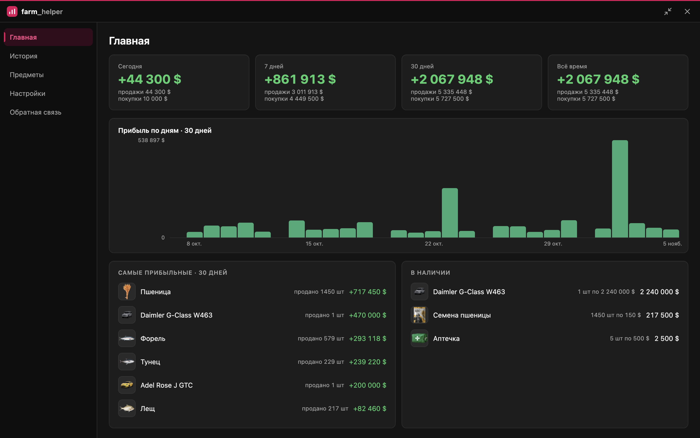
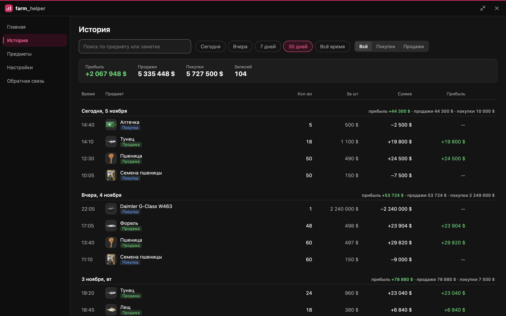
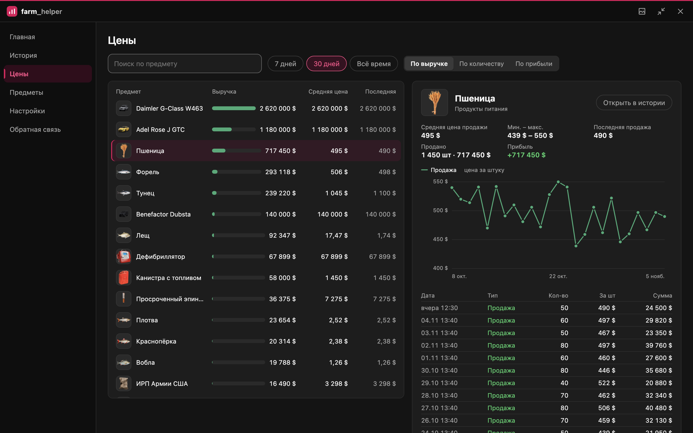
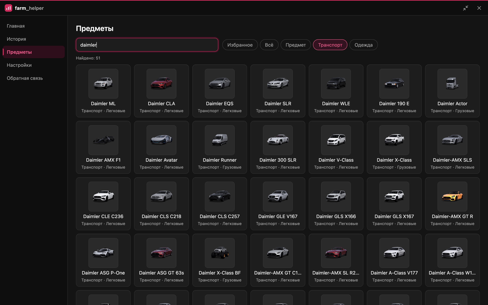
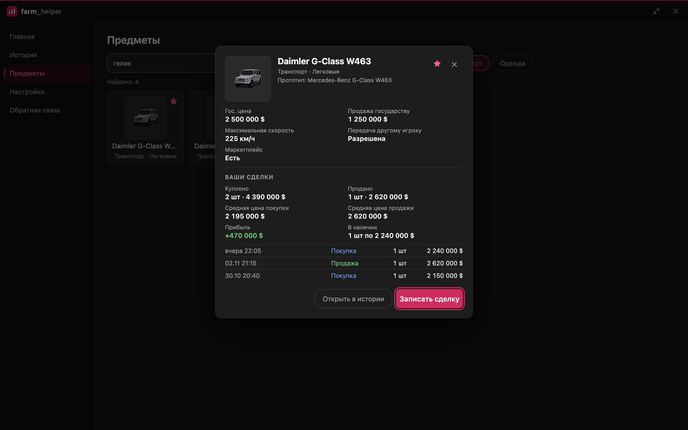
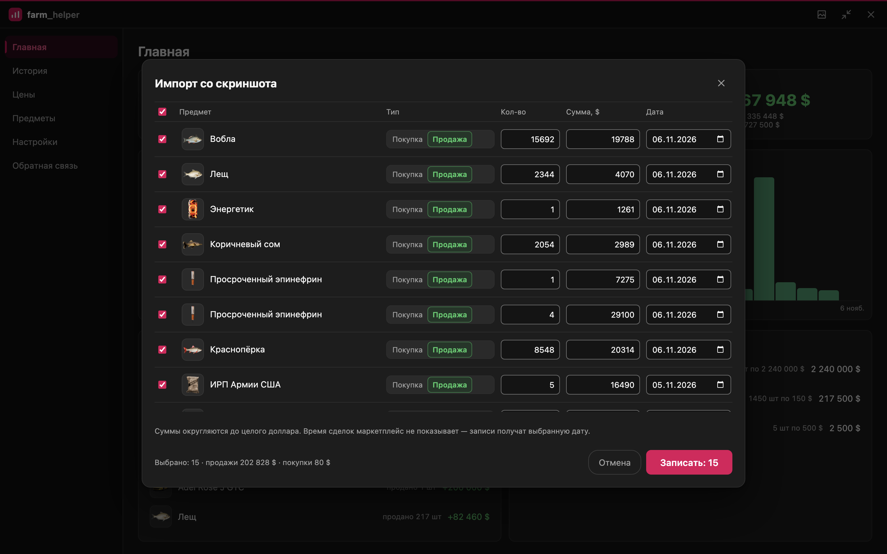
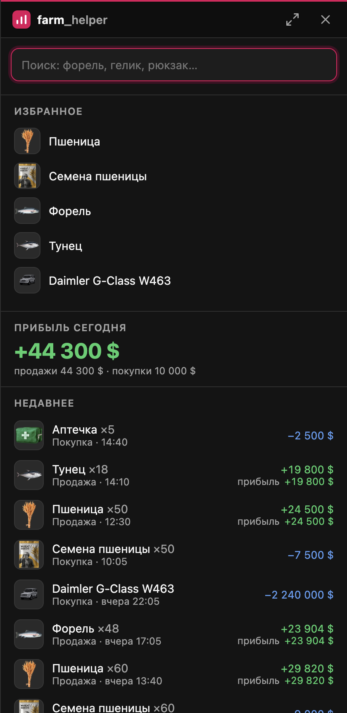
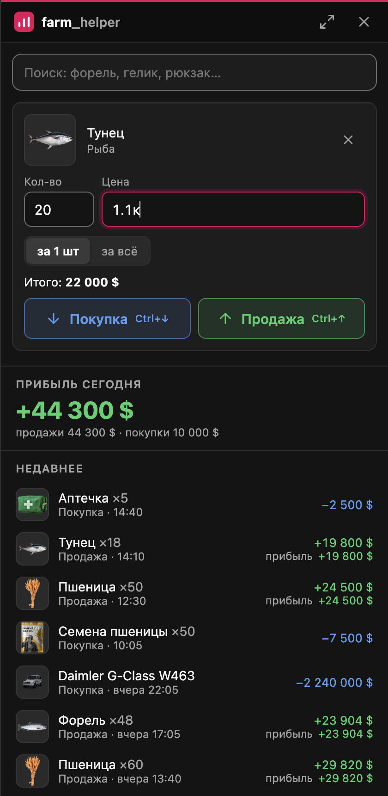

  

  
  

  

**farm_helper** — учёт покупок и продаж для Majestic RP. Окно открывается поверх игры по клавише F7: выберите предмет, укажите цену и отметьте покупку или продажу. Прибыль по каждой сделке, за день, неделю и всё время рассчитывается автоматически.

## Возможности

- **Окно поверх игры.** Панель открывается и скрывается клавишей F7 в режиме «Оконный без рамки». Клавишу можно изменить.
- **Быстрая запись.** Поиск по каталогу с изображениями, цены в формате «500к» и «1.5кк», избранные предметы — в один клик.
- **Автоматическая прибыль.** Расчёт по средней цене покупки с учётом остатков.
- **История и статистика.** График прибыли по дням, самые прибыльные предметы, остатки, фильтры по периоду, типу и предмету.
- **История цен.** Рейтинг предметов по выручке, количеству и прибыли; график цены за штуку по дням.
- **Каталог Majestic RP.** Более 28 000 предметов, транспорта и одежды. Карточка предмета: сведения с вики и статистика ваших сделок; для транспорта — гос. цена и цена продажи государству.
- **Импорт со скриншота.** Скриншот «Истории сделок» маркетплейса вставляется клавишами Ctrl+V — сделки распознаются и после проверки записываются разом. Уже записанные отмечаются автоматически.
- **Данные под контролем.** Журнал хранится только на вашем компьютере. Резервная копия и выгрузка в Excel — в настройках.
- **Автоматические обновления.** Новые версии загружаются в фоне и устанавливаются при перезапуске.

## Скриншоты

<table>
  <tr>
    <td width="50%" valign="top">
      
       <b>Главная</b> — прибыль за периоды, график по дням, самые прибыльные предметы
    </td>
    <td width="50%" valign="top">
      
       <b>История</b> — сделки по дням, фильтры и поиск
    </td>
  </tr>
  <tr>
    <td width="50%" valign="top">
      
       <b>Цены</b> — рейтинг предметов и график цены за штуку
    </td>
    <td width="50%" valign="top">
      
       <b>Предметы</b> — каталог предметов, транспорта и одежды
    </td>
  </tr>
  <tr>
    <td width="50%" valign="top">
      
       <b>Карточка предмета</b> — сведения с вики и статистика сделок
    </td>
    <td width="50%" valign="top">
      
       <b>Импорт со скриншота</b> — проверка распознанных сделок перед записью
    </td>
  </tr>
</table>

  
  &nbsp;&nbsp;
  
   
  <b>Панель поверх игры</b> — избранное, итог дня и запись сделки

<a href="https://aquadelin.github.io/farm_helper-releases/"><b>Открыть все скриншоты в альбоме →</b></a>

## Установка

1. Скачайте `farm_helper-Setup-<версия>.exe` из [последнего релиза](https://github.com/aquadelin/farm_helper-releases/releases/latest).
2. Запустите установщик. Если появится окно «Система Windows защитила ваш компьютер», нажмите **«Подробнее» → «Выполнить в любом случае»**. Предупреждение связано с отсутствием платной цифровой подписи.
3. Выберите папку установки и отметьте, нужен ли ярлык на рабочем столе.

Права администратора не требуются. Приложение не добавляется в автозагрузку Windows.

## Использование

1. В настройках графики GTA V выберите режим **«Оконный без рамки»**. В полноэкранном режиме окно приложения не отображается поверх игры.
2. Нажмите **F7**, чтобы открыть или скрыть панель.
3. Найдите предмет, укажите количество и цену, нажмите «Покупка» или «Продажа».
4. Кнопка ⤢ открывает полный режим: главная, история, каталог предметов, настройки.

### Импорт со скриншота

Сделки с маркетплейса не нужно вводить вручную — достаточно скриншота раздела «История сделок».

1. Откройте маркетплейс → «История сделок».
2. Нажмите **Win+Shift+S** и выделите область с карточками сделок.
3. Вернитесь в farm_helper и нажмите **Ctrl+V**.
4. Проверьте таблицу: при необходимости исправьте предмет, количество или сумму. Уже записанные сделки отмечены и повторно не записываются.
5. Нажмите «Записать».

Количество, название, тип сделки, цена и дата распознаются автоматически. Распознавание выполняется на компьютере, изображение никуда не передаётся.

## Безопасность

- Приложение работает как обычное окно Windows: не читает память игры, не нажимает клавиши и не делает снимков экрана.
- Скриншоты для импорта вы делаете и вставляете сами. Распознавание выполняется на компьютере, изображение никуда не передаётся.
- Журнал сделок хранится локально в `%APPDATA%\farm-helper` и никуда не передаётся.
- Сетевые запросы: проверка обновлений (GitHub), изображения каталога (сервер изображений Majestic RP) и сообщения обратной связи, если вы их отправляете (Google Формы).

## Частые вопросы

**Окно не появляется поверх игры.** Включите в GTA V режим «Оконный без рамки».

**Клавиша F7 не срабатывает.** Её заняла другая программа. Назначьте другую клавишу: полный режим → «Настройки» → «Горячая клавиша».

**Как перенести записи на другой компьютер?** «Настройки» → «Резервная копия» → «Сохранить копию». На новом компьютере — «Восстановить из копии».

**Как удалить приложение?** «Параметры Windows» → «Приложения» → farm_helper → «Удалить». Журнал остаётся в `%APPDATA%\farm-helper`; удалите эту папку, если записи больше не нужны.

**Импорт не нашёл сделки на скриншоте.** Нужен скриншот раздела «История сделок» маркетплейса: карточки с количеством, названием, ценой и датой. Подойдёт и скриншот части экрана с несколькими карточками.

**Разрешено ли приложение на сервере?** farm_helper не взаимодействует с игровым клиентом. Правила использования стороннего ПО устанавливает администрация сервера.

## Обратная связь

Сообщения об ошибках и предложения: полный режим → **«Обратная связь»**.

---

Неофициальный проект. Не связан с Majestic RP и Rockstar Games. Названия и изображения игровых предметов принадлежат их правообладателям.
