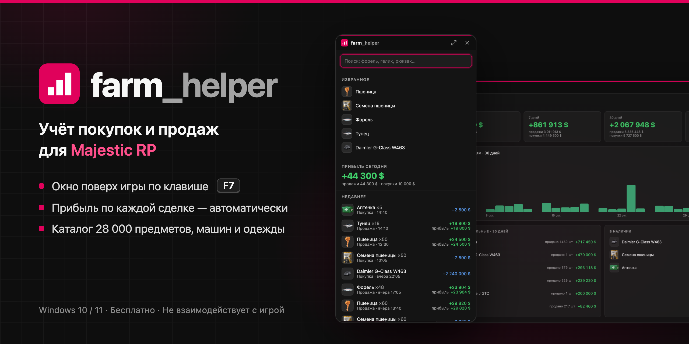

  

  
  

  

<a href="https://aquadelin.github.io/farm_helper-releases/"><b>Сайт: возможности и скриншоты →</b></a>

**farm_helper** — учёт покупок и продаж для Majestic RP. Окно открывается поверх игры по клавише F7: выберите предмет, укажите цену и отметьте покупку или продажу. Прибыль за день, неделю и всё время рассчитывается автоматически.

- Прибыль по средней цене покупки, расходы и цель на день или неделю.
- Таймер фарма: доход в час по рыбалке, охоте и другим занятиям.
- Импорт сделок со скриншота маркетплейса, история цен, отчёт за неделю картинкой.
- Каталог Majestic RP: более 28 000 предметов, транспорта и одежды.

Подробное описание всех функций — в приложении: полный режим → «Справка».

## Установка

1. Скачайте `farm_helper-Setup-<версия>.exe` из [последнего релиза](https://github.com/aquadelin/farm_helper-releases/releases/latest).
2. Запустите установщик. Если появится окно «Система Windows защитила ваш компьютер», нажмите **«Подробнее» → «Выполнить в любом случае»**. Предупреждение связано с отсутствием платной цифровой подписи.
3. В настройках графики GTA V выберите режим **«Оконный без рамки»** и нажмите **F7**.

Права администратора не требуются. Приложение не добавляется в автозагрузку Windows. Новые версии устанавливаются автоматически.

## Безопасность

- Приложение работает как обычное окно Windows: не читает память игры, не нажимает клавиши и не делает снимков экрана.
- Журнал хранится локально в `%APPDATA%\farm-helper` и никуда не передаётся. Скриншоты для импорта распознаются на компьютере.
- Сетевые запросы: проверка обновлений (GitHub), изображения каталога (сервер изображений Majestic RP), обновление каталога по кнопке в настройках (вики Majestic RP) и сообщения обратной связи, если вы их отправляете (Google Формы).

## Частые вопросы

**Окно не появляется поверх игры.** Включите в GTA V режим «Оконный без рамки».

**Клавиша F7 не срабатывает.** Её заняла другая программа. Назначьте другую клавишу: полный режим → «Настройки» → «Горячая клавиша».

**Как перенести записи на другой компьютер?** «Настройки» → «Резервная копия» → «Сохранить копию». На новом компьютере — «Восстановить из копии».

**Как удалить приложение?** «Параметры Windows» → «Приложения» → farm_helper → «Удалить». Журнал остаётся в `%APPDATA%\farm-helper`; удалите эту папку, если записи больше не нужны.

**Разрешено ли приложение на сервере?** farm_helper не взаимодействует с игровым клиентом. Правила использования стороннего ПО устанавливает администрация сервера.

## Обратная связь

Сообщения об ошибках и предложения: полный режим → **«Обратная связь»**.

---

Неофициальный проект. Не связан с Majestic RP и Rockstar Games. Названия и изображения игровых предметов принадлежат их правообладателям.
